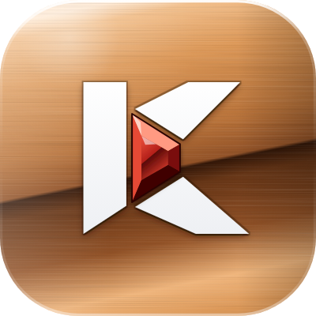

# Keystone MCP server

Keystone lets your AI do real jobs in the apps your business already uses: your phone line and call recordings, Google Business Profile, Google and Meta ads, analytics, reviews, calendar, CRM, accounting, email and hosted websites. Web apps with no API work through API Anything, which runs the task in a cloud browser. Agencies keep a separate workspace for each client.

**Server URL:** `https://keystonecloud.ai/mcp` (streamable HTTP, OAuth sign-in)

[](https://cursor.com/en/install-mcp?name=keystone&config=eyJ1cmwiOiJodHRwczovL2tleXN0b25lY2xvdWQuYWkvbWNwIn0%3D)
[](https://insiders.vscode.dev/redirect/mcp/install?name=keystone&config=%7B%22type%22%3A%22http%22%2C%22url%22%3A%22https%3A//keystonecloud.ai/mcp%22%7D)

This repository holds the public listing files: [`server.json`](server.json) for the [official MCP Registry](https://registry.modelcontextprotocol.io) (`ai.keystonecloud/keystone`) and an [agent skill](skills/keystone-cloud/SKILL.md). The server itself is hosted; there is nothing to build or run.

## What you can ask

- "Show me last week's calls and play the one that booked a job."
- "How do we rank on Google Maps for dentist near me?"
- "Pull 14 days of Google Ads search terms and block the ones that wasted money."
- "Answer this week's five-star reviews."
- "Find a Tampa phone number for our website and buy it."
- "Switch to Fernleaf Goods and run the reviews playbook."

## Connect your AI

Every app below signs in through your browser the first time. No client id, secret or API key to copy. Full guide with screenshots: https://keystonecloud.ai/connect-your-ai

**Claude (web and desktop):** Settings, Connectors, Add custom connector. Name it Keystone, paste `https://keystonecloud.ai/mcp`, then Connect.

**ChatGPT:** Settings, Connectors (or Apps), Advanced settings, turn on Developer mode. Create a connector with the URL `https://keystonecloud.ai/mcp` and OAuth.

**Grok Bot:** Connect apps, Add a custom connector, type Remote HTTPS, URL `https://keystonecloud.ai/mcp`.

**Claude Code:**

```bash
claude mcp add --transport http keystone https://keystonecloud.ai/mcp
```

Then type `/mcp` in Claude Code and sign in.

**Codex:**

```bash
codex mcp add keystone --url https://keystonecloud.ai/mcp
codex mcp login keystone
```

**Cursor:** use the Add to Cursor button above, or add this to `~/.cursor/mcp.json`:

```json
{ "mcpServers": { "keystone": { "url": "https://keystonecloud.ai/mcp" } } }
```

**VS Code:**

```bash
code --add-mcp '{"name":"keystone","type":"http","url":"https://keystonecloud.ai/mcp"}'
```

**Hermes Agent:**

```bash
hermes mcp add keystone --url https://keystonecloud.ai/mcp --auth oauth
hermes mcp login keystone
```

**OpenClaw:**

```bash
openclaw mcp add keystone --url https://keystonecloud.ai/mcp --transport streamable-http --auth oauth
openclaw mcp login keystone
```

**T3 Code:** T3 Code runs Claude Code, Codex and other agents with each agent's own MCP config. Add Keystone to Claude Code or Codex as above and open a new thread.

**Anything else:** any app that supports remote MCP over streamable HTTP works with `https://keystonecloud.ai/mcp`. Apps that cannot open a browser sign-in can send a personal token from https://keystonecloud.ai/setup as `Authorization: Bearer <token>`.

## Agent skill

[`skills/keystone-cloud/SKILL.md`](skills/keystone-cloud/SKILL.md) teaches an agent which Keystone tools to use for each job. It follows the [Agent Skills](https://agentskills.io) format, so it works in Claude, OpenClaw, Hermes Agent and other agents that load skills.

```bash
hermes skills install ServiceLine-Pro/keystone-mcp/skills/keystone-cloud
```

## Pricing

Personal is $19 a month for one business. Agency is $79 a month for unlimited client workspaces. Both start with a 14-day free trial, no card needed. Tool calls are unlimited. Phone numbers, domains, calls and postcards are paid from a prepaid wallet. Details: https://keystonecloud.ai/pricing

## Links

- Website: https://keystonecloud.ai
- Setup guide: https://keystonecloud.ai/connect-your-ai
- Apps Keystone connects: https://keystonecloud.ai/apps
- Privacy: https://keystonecloud.ai/privacy
- Terms: https://keystonecloud.ai/terms
- Support: support@keystonecloud.ai
